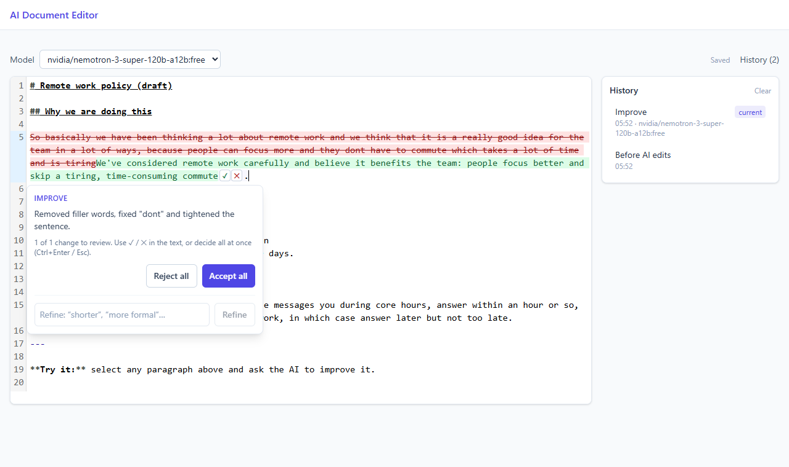

# AI Document Editor

A Markdown editor with an AI co-author. Select some text, ask for a change, and the AI's suggestion appears **inline as tracked changes**. You accept or reject each change, refine the suggestion with a follow-up, and can go back to any earlier version.

Built for the Chiri engineering assessment.



## How to run

Requirements: Python 3.14 with [uv](https://docs.astral.sh/uv/), Node 22+, and an [OpenRouter](https://openrouter.ai/settings/keys) API key. `make` is optional (on Windows, use Git Bash).

```bash
cp .env.example .env          # then set LLM_API_KEY in .env
make install                  # backend (uv) + frontend (npm) dependencies
make backend                  # terminal 1: API on http://localhost:8000
make frontend                 # terminal 2: app on http://localhost:5173
```

Without `make`:

```bash
cd backend && uv sync && uv run uvicorn src.main:app --reload --port 8000
cd frontend && npm install && npm run dev
```

Open http://localhost:5173. An example document is loaded on the first visit, so you can try the AI right away.

`.env.example` lists two free OpenRouter models (`:free`, no credits needed, about 50 requests a day). Any OpenAI-compatible provider works: set `LLM_BASE_URL`, `LLM_API_KEY` and `LLM_MODELS`.

Checks: `make test` (backend, 28 tests, the AI is mocked), `make lint`, `make build`.

## How to use it

1. **Select text.** A small popup offers **Improve**, **Shorter** and **Formal**, or you can type your own instruction.
2. **Review the suggestion.** Removed words are red and struck through, new words are green. Each change has its own ✓ / ✕, and the card under the text has **Accept all** / **Reject all** and the AI's reason for the edit.
3. **Refine it.** Type a follow-up in the card ("shorter", "add an example"). The AI builds on its last answer, and the diff updates against your original text.
4. **Go back if needed.** The **History** panel lists every applied AI edit with a diff of what it changed. **Restore** brings back any earlier version.

| Shortcut | Action |
|---|---|
| Ctrl/⌘ + K | Focus the instruction box for the selected text |
| Ctrl/⌘ + Enter | Accept all changes |
| Esc | Reject the suggestion (or cancel it while it loads) |
| Ctrl/⌘ + Z | Undo an applied AI edit or a restore (one step each) |

## What I built

My reading of "collaborative" is that **the user stays the author**. The AI works on the passage you point it at, you see exactly what it wants to change, and nothing reaches your document without your say.

- **Scoped edits with full context.** The model sees the whole document, so it keeps terms and tone consistent, but it may rewrite only the selected passage. It can't take over the document.
- **Inline tracked changes.** The diff sits where you are reading, instead of a side-by-side view or a chat panel. It is a word-level diff, and changes split by one or two unchanged words are merged, so a full rewrite reads as one change and a typo fix stays precise.
- **Decide per change.** You can take the AI's better verb and keep your own sentence. Partial results are written to the document in one transaction, so one Ctrl+Z undoes the AI edit.
- **Multi-turn refine.** Earlier rounds are sent as conversation turns, so "now more formal" builds on the last version. The card shows the trail (Improve → Shorter → Formal).
- **Version history.** Every applied edit is saved with its label, model and diff. Restoring is also recorded, so you can't lose a version.
- **The model is your choice.** A picker shows the models from config. When a free model is busy, the error says so and suggests another one.

### Architecture

```
frontend (React + CodeMirror 6)                 backend (FastAPI)                OpenRouter
selection → popup → POST /suggestions  ──────▶  prompt + tag parsing  ──────▶  /chat/completions
inline diff (jsdiff) ← {replacement, reason} ◀──  LlmClient (httpx)     ◀──────
history + document in localStorage
```

- **Backend** (`backend/src`): a thin proxy, so the API key never reaches the browser. `use_cases/suggestions/create_suggestion/prompt.py` holds the prompt and parses the model's `<replacement>…</replacement><reason>…</reason>` answer. `llm/llm_client.py` is about 115 lines of httpx for any OpenAI-compatible API. Its logs record model, latency and tokens, never document text.
- **Frontend** (`frontend/src/components/Editor`): `codemirror/suggestionField.ts` keeps the open suggestion in CodeMirror state. Its range follows edits elsewhere and is locked while you review, and the diff is drawn with decorations. `diff/diffSegments.ts` turns the jsdiff output into reviewable changes.
- The full list of decisions, with a reason for each, is in [`docs/PLAN.md`](docs/PLAN.md).

### Trade-offs: what I left out on purpose

- **No database, Docker or auth.** The brief asks for no extra infrastructure. One user's document and history fit in localStorage.
- **No streaming.** The output is a diff, and with streaming it would jump on every token. Rewriting a paragraph takes about 2 s, so a loading state works fine.
- **No LangChain or LangSmith.** This is one API call with no agents, tools or retrieval. A small httpx client is easier to read and debug.
- **One open suggestion at a time.** Several suggestions with overlapping ranges add a lot of complexity for little gain in a single-user editor.
- **Raw Markdown, not WYSIWYG.** A text editor makes diffs exact and simple. Rich-text diffs over a document tree are much harder to get right.
- **Tagged output instead of JSON mode.** Not every free model supports JSON mode, and escaping Markdown inside JSON breaks easily.

## What I'd do differently with more time

- **Frontend tests.** Add Vitest for `diffSegments` and the CodeMirror state field. I checked the diff logic with a script and the UI with Playwright by hand, but those checks aren't part of the repo yet.
- **Prompt evaluations.** Build a small set of documents and instructions, scored for "edits only the selection", "keeps Markdown" and "follows the format", to compare models and prompt changes.
- **Smarter rate-limit handling.** Free models are often busy. The app could retry with the next model automatically.
- **Proactive review.** A "Review document" action where the AI proposes several small edits across the whole document. This needs several open suggestions at once.
- **Streaming the reason.** Show the AI's explanation while the replacement is still generating, then show the diff once it's complete.
- **Rendered Markdown preview** next to the source, and a rich-text mode.
- **Real-time multi-user editing** (e.g. Yjs), with AI suggestions visible to every collaborator.
- **Clean up template leftovers:** `zod` is unused, and `react-router` serves a single route.

## How I used AI to build this

The whole project was built in one Claude Code session. The transcript is in [`ai-sessions/`](ai-sessions/).

- I started from my own full-stack template. Claude read it against the brief, and we removed what the assessment doesn't need: AWS, Docker, Postgres and the sample feature.
- I set the rules for working together in `CLAUDE.md`: Claude asks with options and never picks the stack alone. Every library and design choice was a short discussion, recorded in `CLAUDE.md` and `docs/PLAN.md`.
- We built in seven small steps, one commit each. After each step Claude ran lint, type checks and tests, and tested in a real browser with Playwright. To save the free quota, the AI was faked in most browser tests, with a few real calls at the end of each step.
- Browser testing caught real bugs: a triple-click ate the paragraph break, the popup appeared on empty lines, the suggestion card appeared late, and Gemma's free endpoint was often busy upstream.
